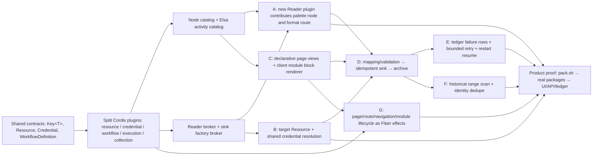

# Task dependency graph (collector §16 item 8)

The first-round items (inventory, capability matrix, tech check, Elsa PoC,
plan) were prerequisites, not product features. Their executable dependency
graph into the implemented scenarios is:

Legend: A–G are the collector §15 acceptance scenarios. Every arrow is a real
capability dependency (`Inject()` → `Provide()`), not a documentation link.

The graph is intentionally acyclic: UI contribution data never drives plugin
activation, and retry never mounts a new component during cleanup.
